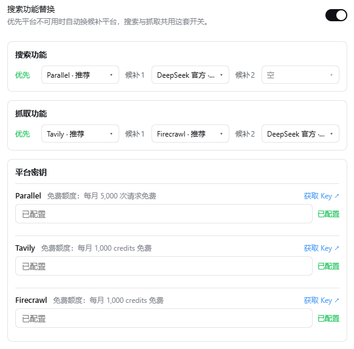

# DSH-Enhance

DSH（DeepSeek Harness）插件，给会话管理和网页搜索加四件事。

## 功能

### 删除对话

会话行和归档行的「…」菜单多一项「删除对话」，二次确认后把转录、工作区记账、归档标记与 spill 一起清掉，不留半截。

### 迁移对话

- **单条**：把对话行拖到目标工作区的行上（落点有虚线高亮）。
- **整个工作区**：工作区「…」→「迁移工作区」，选目标后一次迁走。

迁移会在目标路径下重建一份带完整历史的对话，再删除原对话（不进入归档）。工作区归属由会话 header 的 `cwd` 决定且 header 不可改写，所以只能重建。

### 迁移记录

每次迁移前自动备份完整对话。「设置 → 增强设置」→「迁移记录」列出历史（对话名、从哪个工作区到哪个、时间），可把对话一键恢复到迁移前的工作区。

记录与备份保留 **3 天**，DSH 启动时自动清理过期项。

### 搜索 / 抓取替换

把网页搜索与抓取换成一串「优先 → 候补」平台，前一家不可用（没 key、限流、超时、没抓到正文）就自动换下一家。

| 平台 | 搜索 | 抓取 | 免费额度 |
| --- | --- | --- | --- |
| Parallel | ✅ | — | 每月 5,000 次 |
| Tavily | ✅ | ✅ | 每月 1,000 credits |
| Firecrawl | ✅ | ✅ | 每月 1,000 credits |

选 DeepSeek 官方时请求原样转交宿主，key 与账号令牌都由宿主管理，本插件不复制、不另存。搜索与抓取各三个槽位（优先、候补 1、候补 2），整条链 28 秒预算；页面确实 404/410 时不降级。



上图即「设置 → 增强设置」里的样子：一个总开关管搜索与抓取，两条链各自选平台，下方填各平台密钥。

## 安装

```bash
git clone https://github.com/AnbaoIy/DSH-Enhance.git
dsh plugin --profile desktop add link:C:/path/to/DSH-Enhance
```

或直接改 `~/.dsh/profiles/desktop/package.json`：

```json
{
  "dependencies": { "dsh-enhance": "link:C:/path/to/DSH-Enhance" },
  "dsh": { "profile": { "bundles": ["@deepseek-ai/dsh-base", "@deepseek-ai/dsh-web-app", "dsh-enhance"] } }
}
```

插件自带 `cordis.patch.yml`，把 `web` 的 `searchProvider` / `fetchProvider` 指向本插件。重启 DSH 后出现「设置 → 增强设置」。

> 不要与 `dsh-webenhance`、`@michengai/dsh-archive-manager` 同时启用：三者争用同一个会话菜单槽位与 web provider id。

## 设置项

| 开关 | 作用 |
| --- | --- |
| 删除对话功能 | 关掉后会话菜单不再出现「删除对话」 |
| 工作区迁移功能 | 关掉后拖拽与「迁移工作区」都不可用 |
| 搜索功能替换 / 抓取功能替换 | 关掉后交还宿主内置 provider |

同页还可配各平台 key、优先-候补链与超时。密钥存入 DSH 凭据服务，不写设置文件、不进日志。

## 常见问题

- **迁移后原对话在哪？** 已删除，不进归档；3 天内在「迁移记录」里点「恢复」可以找回。
- **「恢复」是灰的？** 那条记录由旧版插件留下，没有对应备份文件。
- **迁移后侧边栏显示「未命名」？** 旧版本的问题，现在迁移完会立刻写好标题缓存；已受影响的对话点开一次即可。
- **搜索没走我配的平台？** 确认开关已开、该平台在优先位、key 已保存。

## 开发

```bash
npm test
```

测试用 `test/register-shims.mjs` 把 `@deepseek-ai/*` 的裸导入指向 `test/shims/` 替身，不需要 DSH 本体。改完宿主侧代码需重载插件或重启 DSH；改完 `lib/client.js` 需整页刷新。

## 许可

MIT
